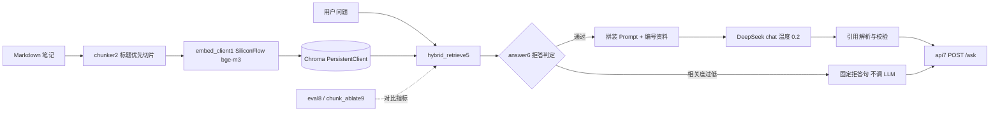

# opengauss-rag

openGauss **配置问答助手**（纯 RAG，手写主链路）。语料来自开源实习中的 B 兼容 / Dolphin MySQL 协议 / Peewee 适配笔记，目标是把分散的配置说明变成可检索、可引用、不足可拒答的问答服务。

> 小样本离线评测与 demo，**不是**生产级准确率。

## 背景

参与 openGauss 开源适配时发现：B 库创建、schema 与 PyMySQL `database` 同名、`enable_dolphin_proto` / native 密码等配置点散落在文档与个人笔记中，新手很难一次查准。本项目将个人整理的 `personal/peewee-notes.md` 切片入库，提供：

- 混合检索（BM25 + 向量 + 加权 RRF + 标识符提权）
- 基于资料的生成与 `[n]` 引用
- 检索层代码拒答（相关度过低时不调用大模型）
- FastAPI `POST /ask`
- 离线评测（纯向量 vs 混合、越界题拒答、切片长度消融）

## 架构



### 代码流水线（文件名编号 = 执行顺序）

| 文件 | 职责 |
|------|------|
| `src/embed_client1.py` | SiliconFlow 嵌入客户端（含超时/SSL 重试） |
| `src/chunker2.py` | Markdown 标题优先切片，默认 max_chars=1200 / overlap=120 |
| `src/ingest3.py` | 切片 → 嵌入 → 入库 `opengauss_docs` |
| `src/retrieve4.py` | 纯向量检索冒烟 |
| `src/hybrid_retrieve5.py` | BM25 + 向量，加权 RRF + snake_case 提权 |
| `src/answer6.py` | 拒答判定 → Prompt → LLM → 引用校验 |
| `src/api7.py` | FastAPI：`GET /health`、`POST /ask` |
| `src/eval8.py` | 离线评测：Recall@k + OOS 拒答 |
| `src/chunk_ablate9.py` | 切片长度消融（临时集合 `opengauss_c*`） |
| `src/peek_signals.py` | 打印 bm25_raw / vec_dist，用于阈值标定 |
| `src/ask_smoke.py` | HTTP smoke（`httpx`，`trust_env=False`） |

## 技术选型（简要）

| 选择 | 原因 |
|------|------|
| 手写链路，不用 Agent/LangChain 编排 | 链路短、可调试、面试可讲清每一步 |
| Chroma PersistentClient + cosine | 本地向量库，成本低，和 bge-m3 匹配 |
| BM25 + 向量 + 加权 RRF | 标识符配置项靠词法，自然语言靠语义；无标识符时向量权重更高 |
| 检索层拒答（BM25 原始分 / 向量距离） | 不能只靠 System Prompt；中文单字 BM25 会虚高，故用 OR 规则 |
| DeepSeek `requests` 直调 | 无框架黑盒，便于控制 messages 与超时 |
| API 注入单例 `HybridRetriever` | 避免每次 `/ask` 重建 BM25 |

## 快速开始

### 环境

- Python 3.10+
- 已创建 venv（示例使用仓库内 `.venv`）

```powershell
cd opengauss-rag
python -m venv .venv
.\.venv\Scripts\activate
pip install -r requirements.txt
copy .env.example .env
# 编辑 .env，填入 SILICONFLOW_API_KEY 与 DEEPSEEK_API_KEY
```

**切勿提交 `.env`**（已在 `.gitignore`）。

### 入库

```powershell
python src\ingest3.py
```

预期：`chunks=20`（以 `peewee-notes.md` 实际切片为准），`collection_count` 与之一致。

### 命令行问答

```powershell
python src\answer6.py "enable_dolphin_proto 是干什么的？"
python src\answer6.py "今天西安天气怎么样？"
```

第二条应输出 `refused=True`，原因多为 `low_bm25` 或 `high_vector_distance`。

### HTTP 服务

```powershell
.\.venv\Scripts\python -m uvicorn api7:app --app-dir src --reload --port 8000
```

另开终端：

```powershell
.\.venv\Scripts\python src\ask_smoke.py
```

- `GET /health` → `status=ok`
- 文档页：`http://127.0.0.1:8000/docs`

### 离线评测与消融

```powershell
python src\eval8.py
python src\chunk_ablate9.py
```

报告：

- `docs/eval_report.md`
- `docs/chunk_ablate.md`
- 检索 badcase：`docs/badcases.md`
- API smoke：`docs/api_smoke_results.txt`

## 拒答规则（当前实现）

```text
no_hits
或 max(bm25_raw_score) < 2.0          → low_bm25
或 min(vector_distance) > 0.55        → high_vector_distance
```

阈值来自 `peek_signals` + 评测集小样本标定，语料扩充后需重标。

## 评测结果（仓库内实测，非生产）

### 纯向量 vs 混合（8 道来源题 + 4 道越界题）

| 方法 | Recall@1 | Recall@3 |
|------|----------|----------|
| 纯向量 | 87.50% | 100% |
| 混合 BM25+向量 | 100% | 100% |

- 纯向量 Top1 失败例：`enable_dolphin_proto`（标识符被语义相近片段冲淡）→ 混合后回到 Top1  
- 越界题代码层拒答：4/4（100%）

### 切片长度消融（混合检索，关键词 Recall）

| max_chars | chunks | Recall@1 | Recall@3 |
|-----------|--------|----------|----------|
| 400 | 42 | 100% | 100% |
| 800 | 24 | 100% | 100% |
| 1200 | 20 | 100% | 100% |
| 1600 | 18 | 100% | 100% |

在关键词 Recall 口径下 400–1600 打平；该口径**偏松**，不能证明切片对生成质量无影响。生产默认保留 **1200**。

## 限制与后续

- 语料目前以个人笔记为主，覆盖有限；官方文档未大规模入库  
- 关键词 Recall 不能替代生成质量评测；尚无答案正确率 / 幻觉率人工标注  
- 未做 cross-encoder 重排；标题短块偶尔排位偏高（见 badcases）  
- 拒答阈值依赖当前语料分布，扩充后必须重跑 `peek_signals` / `eval8`  
- 未使用 Agent / 工具调用编排（刻意保持主链路可讲解）

## 相关项目

openUBMC API 文档一致性校验（纯 Python diff，无大模型）见独立目录/仓库：`ubmc-doc-check`。

## License

个人学习项目，代码可自由查看；openGauss 文档与笔记版权归原作者与社区规则约束。
