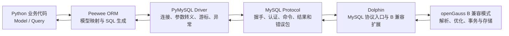

# openGauss B 兼容模式 × Peewee 任务面试速查

> 适用目的：秋招面试前快速理解本任务的技术链路、测试证据、兼容问题与个人贡献边界。
>
> 审核基线：2026-09-17 任务验收状态。Plugin #2553、openGauss-server #9709、examples #114 和 docs #8846 均已合入，任务已验收并获得积分。

## 先记住这段 60 秒项目介绍

这个任务不是“给 Peewee 写一个 openGauss 驱动”，而是验证现有 MySQL 生态链路能否复用：Peewee 使用 MySQL 后端生成 SQL，PyMySQL 按 MySQL 协议连接 Dolphin 暴露的端口，Dolphin 再让 SQL 在 openGauss B 兼容数据库中执行。

我搭建并适配了测试环境，编写了 48 条 pytest 自动化用例和 2 条人工稳定性用例，覆盖连接、DDL、CRUD、查询、事务、关系、数据类型、字符集和异常映射。修复前在 openGauss 7.0.0-RC3 + Dolphin 5.2 上连续两次得到 46 PASS、2 FAIL，定位出 MySQL 元数据和重复键错误语义两类兼容问题。我通过 PyMySQL 直连、MySQL 客户端、系统视图和 Peewee 源码分层定位，完成 Plugin、openGauss-server、examples 和 docs 四个 PR。四个 PR 合入后，在同一 Server + Plugin master 上联合编译成功，48 条测试连续两轮全部通过，并直接确认 MySQL `1062/23000`、PyMySQL/Peewee `IntegrityError` 以及完整元数据结果。

【注】DDL:**Data Definition Language，数据定义语言。**它用来定义和修改数据库的**结构**，不直接操作具体数据行
**CRUD = Create、Read、Update、Delete**，是应用对数据最基础的四种操作。它不是一个 SQL 语法，而是一种**功能抽象**。

| CRUD       | 含义   | 对应 SQL   | 对应 HTTP         |
| ---------- | ---- | -------- | --------------- |
| **C**reate | 新增数据 | `INSERT` | `POST`          |
| **R**ead   | 查询数据 | `SELECT` | `GET`           |
| **U**pdate | 修改数据 | `UPDATE` | `PUT` / `PATCH` |
| **D**elete | 删除数据 | `DELETE` | `DELETE`        |
* **DDL**：管“数据库结构”的，比如建表、改表、删表。

* **CRUD**：管“表里数据”的，比如增、查、改、删。
---

## 1. 这个任务到底在验证什么

### 1.1 通俗理解

假设一个 Python 项目原来使用：

- Peewee 表达“我要建什么表、查什么数据”；
- PyMySQL 负责和 MySQL 通信；
- MySQL 负责真正执行。

现在希望尽量不改业务代码，把数据库换成 openGauss。问题是：PyMySQL 只会讲 MySQL 协议，Peewee 的 MySQL 后端也会生成 MySQL 风格 SQL，并依赖 MySQL 风格的元数据和错误码。

因此任务要验证的不只是“端口能连通”，而是整条链路是否真的可用：

1. 能否完成 MySQL 协议握手和认证；
2. Peewee 生成的 MySQL 风格 SQL 能否执行；
3. 数据能否正确写入、查询、更新和删除；
4. 事务、外键、多对多、字符集等常见能力是否正确；
5. 元数据是否符合 MySQL/Peewee 的精确约定；
6. 错误包是否能让 PyMySQL 和 Peewee抛出正确异常；
7. 相同测试是否可以稳定重复执行。

### 1.2 为什么必须做

“兼容”有很多层。只验证连接成功会漏掉更隐蔽的问题：

- SQL 能执行，但 `SHOW INDEX` 把主键名返回为 `table_pkey`，Peewee 就认为它不是主键；
- 自增列确实能自增，但元数据返回 `AUTO_INCREMENT`，Peewee 用小写字符串匹配，结果 `identity=False`；
- 重复键确实被数据库拒绝，但错误码不是 MySQL 1062，应用的 `except IntegrityError` 就捕获不到；
- 普通字符串正常，但引号、反斜杠、中文或 emoji 可能失败。

所以这项工作的核心是“生态兼容性验证”：不仅看数据库能否完成操作，还要看上层框架是否以它熟悉的 MySQL 语义理解结果。

### 1.3 真实产出与边界

最终产出如下：

| 产出 | 仓库/PR | 最终状态 |
|---|---|---|
| Peewee 测试工程 | examples #114 | 48 条自动化测试、演示脚本、用例清单和最终自测报告已合入 |
| Dolphin/Plugin 修复 | Plugin #2553 | `PRIMARY` 主键名与限定路径重复键 `1062/23000` 映射已合入 |
| openGauss-server 修复 | openGauss-server #9709 | `auto_increment`、DECIMAL 精度及可逆升降级脚本已合入 |
| Peewee 开发指南 | docs #8846 | 企业版与 lite 版官网文档已合入 |

面试中不要把这项任务描述为“重写了 openGauss 内核”或“开发了新的 Peewee 驱动”。更准确的说法是：完成兼容性测试、分层问题定位、限定范围的协议/元数据修复、升降级保护、回归用例和开发文档。

---

## 2. 完整调用链



### 2.1 Python 业务代码

业务代码使用 `Model`、`Field`、`select()`、`where()`、`create()` 和 `atomic()` 等 API，不直接拼接大部分 SQL。

真实示例在 [example_demo.py](./examples/PeeweeTest/example_demo.py)：

```python
alice = Person.create(name='alice', age=18)
oldest = Person.select().order_by(Person.age.desc()).get()

with db.atomic():
    Person.create(name='txn', age=99)
```

### 2.2 Peewee ORM

Peewee 负责：

- 将 Python 类映射为表，将字段映射为列；
- 根据表达式树生成 MySQL 方言 SQL；
- 调用数据库适配类 `MySQLDatabase`；
- 将查询结果转成模型对象；
- 提供事务上下文和 ORM 异常体系。

Peewee 不负责在网络上传输 MySQL 数据包，也不负责数据库真正执行 SQL。

### 2.3 PyMySQL Driver

本任务使用 `PyMySQL==1.2.0`。它负责：

- TCP 连接；
- MySQL 握手与 native password 认证；
- 将 `%s` 参数安全转义到请求；
- 发送 MySQL 命令包；
- 解析结果集、`lastrowid` 和错误包；
- 根据 MySQL 错误码选择 `IntegrityError`、`OperationalError` 等异常。

Peewee 4.3.0 的 `MySQLDatabase._connect()` 最终调用的就是 `pymysql.connect(...)`。本地核对到 Peewee 选择的 `mysql` 模块是 `pymysql`。

### 2.4 MySQL Protocol

协议定义“线上如何说话”，包括：

- 初始握手和能力协商；
- 用户认证；
- 查询命令；
- 字段元数据和数据行的编码；
- OK/EOF/ERR 数据包；
- 错误码和 SQLSTATE。

协议兼容不等于 SQL 兼容。即使握手成功，某条 MySQL SQL 仍可能不被服务端接受；即使 SQL 执行成功，元数据或错误码仍可能不符合 MySQL 约定。

### 2.5 Dolphin

Dolphin 在这个任务中承担两类作用：

1. 为 openGauss B 兼容数据库补充 MySQL 风格语法、函数、类型和行为；
2. 通过 `enable_dolphin_proto` 和 `dolphin_server_port` 提供 MySQL 协议入口。

PyMySQL 并不知道后端是 openGauss；它只知道对方能够进行 MySQL 兼容握手并返回 MySQL 格式的数据包。

### 2.6 openGauss B 兼容模式

通过 `CREATE DATABASE ... DBCOMPATIBILITY 'B'` 创建的数据库，在 SQL 语法和行为上向 MySQL 兼容。它仍然是 openGauss 数据库，不会因此变成 MySQL。

真实测试环境中：

- openGauss 物理数据库：`b_database_utf8`；
- 兼容模式：`B`；
- 编码：`UTF8`；
- 原生协议端口：`15400`；
- Dolphin MySQL 协议端口：`3308`；
- `dolphin.default_database_name=b_database_utf8`；
- PyMySQL 的 `database=b_database` 对应 B 库内的业务 schema。

### 2.7 一次查询实际怎样走

以：

```python
Person.select().where(Person.age >= 18).order_by(Person.age.desc()).limit(2)
```

为例，本地 Peewee 4.3.0 实际生成：

```text
SELECT `t1`.`id`, `t1`.`name`, `t1`.`age`
FROM `demo_person` AS `t1`
WHERE (`t1`.`age` >= %s)
ORDER BY `t1`.`age` DESC
LIMIT %s

params = [18, 2]
```

上述 SQL 中围绕标识符的符号是反引号，实际生成结果也使用反引号引用表名和列名。

执行路径是：

1. Peewee 生成 SQL 和参数；
2. `MySQLDatabase.execute_sql()` 取得 PyMySQL cursor；
3. `cursor.execute(sql, params)` 让 PyMySQL 完成转义并发送；
4. Dolphin 接收 MySQL 查询包并交给 openGauss 执行；
5. 结果包返回 PyMySQL；
6. Peewee 把结果映射为 `Person` 对象。

---

## 3. 核心概念的区别与关系

| 概念 | 回答“什么问题” | 本任务中的实例 |
|---|---|---|
| ORM | Python 对象如何映射表和 SQL | Peewee 的 `Model`、`Field`、`select`、`atomic` |
| 数据库 Driver | Python 如何建立连接并收发数据库协议 | PyMySQL |
| 数据库协议 | 客户端和服务端在线路上如何编码消息 | MySQL Protocol |
| SQL 语法兼容 | 服务端是否接受 MySQL 风格 SQL | 反引号、`AUTO_INCREMENT`、`SHOW TABLES` 等 |
| 数据类型兼容 | 类型能否创建、存储、往返，并以预期元数据呈现 | `DECIMAL(10,2)`、`VARCHAR`、时间、TEXT |
| B 兼容模式 | openGauss 数据库选择哪套 MySQL 兼容语义 | `DBCOMPATIBILITY='B'` |
| Dolphin 插件 | 为 B 模式补充能力，并提供 MySQL 协议入口 | 最终联合验证使用 Dolphin 5.3、端口 3308 |

最容易混淆的三组关系：

1. **ORM 不等于 Driver**：Peewee 负责高级抽象，PyMySQL 负责网络通信。
2. **协议兼容不等于 SQL 兼容**：能连接不代表所有 SQL、类型和错误语义都正确。
3. **B 模式不等于 Dolphin**：B 模式是数据库兼容模式；Dolphin 是补充 B 兼容能力并提供 MySQL 协议的插件。

---

## 4. 实际代码如何连接、生成和执行 SQL

### 4.1 使用的 Driver 与版本

[requirements.txt](./examples/PeeweeTest/requirements.txt) 固定：

```text
peewee==4.3.0
PyMySQL==1.2.0
pytest==9.1.1
```

注意：PyMySQL 1.2.0 的 `pymysql.__version__` 为兼容 MySQLdb 可能显示 `2.2.8`；确认安装包版本应查看 `PyMySQL VERSION_STRING` 或包管理器元数据。本任务依赖声明和安装分发版本均为 1.2.0。

### 4.2 Peewee 连接配置

[conftest.py](./examples/PeeweeTest/tests/conftest.py) 中真实配置：

```python
database = MySQLDatabase(
    cfg['database'],
    host=cfg['host'],
    port=cfg['port'],
    user=cfg['user'],
    password=cfg['password'],
    charset='utf8mb4',
)
```

连接参数含义：

| 参数 | 作用 | 本任务值/来源 |
|---|---|---|
| `host` | Dolphin 所在主机 | 环境变量或 `config.ini` |
| `port` | MySQL 协议端口 | 3308 |
| `user` | openGauss/Dolphin 用户 | `app_user` |
| `password` | MySQL native 密码 | 仅由环境变量或不入库配置提供 |
| `database` | B 物理库内的业务 schema | `b_database` |
| `charset` | 客户端字符集 | `utf8mb4` |

配置优先级为：

```text
PEEWEE_TEST_* 环境变量 > config.ini > 非敏感默认值
```

真实密码没有硬编码，`config.ini` 不提交。

### 4.3 SQL 如何生成

Peewee 根据模型字段与查询表达式生成 MySQL 风格 SQL。例如本地实际生成：

```text
INSERT INTO `demo_person` (`name`, `age`) VALUES (%s, %s)
params = ['alice', 18]

UPDATE `demo_person` SET `age` = %s
WHERE (`demo_person`.`name` = %s)
params = [20, 'alice']
```

不要说“Peewee 直接把 Python 对象发给数据库”。更准确的是：Peewee 把对象操作编译为 SQL 和参数，PyMySQL 再负责协议与参数转义。

### 4.4 openGauss 的 MySQL 兼容体现在哪里

代码和环境中能直接看到：

- `MySQLDatabase` 而不是 PostgreSQLDatabase；
- PyMySQL 连接 3308，而不是 gsql 使用的 15400；
- 标识符使用反引号；
- 表定义使用 `AUTO_INCREMENT PRIMARY KEY`；
- Peewee 内省依赖 `SHOW TABLES`、`SHOW INDEX`、`DATABASE()` 和 `information_schema.columns`；
- 系统变量使用 `@@autocommit`、`@@sql_mode`、`@@transaction_isolation`；
- Dolphin 进行 MySQL 握手、认证和错误包返回；
- B 兼容模式接受相应 SQL、类型与行为。

### 4.5 两个“版本”为什么不同

最终联合验证中：

- `SELECT VERSION()` 返回 openGauss 7.0.0 build `9823273a` 的真实版本；
- Peewee/PyMySQL 从 MySQL 协议握手得到的兼容版本表现为 `(8, 0, 28)`。

这不是同一个字段：

- 前者回答“后端实际是什么数据库版本”；
- 后者帮助 MySQL 客户端选择兼容行为。

---

## 5. 测试了什么

### 5.1 总体统计

- 48 条 pytest 自动化测试；
- 2 条人工稳定性检查；
- 合计 50 个测试项；
- 修复前 RC3 基线连续两次：`46 passed, 2 failed, 0 skipped`，失败稳定为 TC-01-05 和 TC-09-04；
- 最终 openGauss 7.0.0 + Dolphin 5.3 联合环境连续两次：`48 passed in 2.12s` 和 `48 passed in 2.17s`，均为 0 failed、0 skipped、退出码 0；
- 联合编译成功：`BUILD_EXIT=0`；关键连接/元数据/异常预检为 `14 passed`；
- 每轮结束后未发现 `test_` 前缀残留表。

本地再次执行 `pytest --collect-only`，当前代码确实收集到 48 条测试。

### 5.2 按类别梳理

| 类别 | 自动化数量 | 主要验证点 | 最终结果 |
|---|---:|---|---|
| 连接与配置 | 8 | 连接、版本、lastrowid、SHOW、元数据、autocommit、系统变量 | 8 PASS |
| DDL/模型 | 4 | 建删表、IF NOT EXISTS、字段类型、默认值 | 4 PASS |
| CRUD | 6 | 单条/批量插入、查询、更新、删除、get_or_create | 6 PASS |
| 查询 | 6 | WHERE、IN、LIKE、排序、分页、聚合、exists | 6 PASS |
| 事务 | 6 | 提交、异常回滚、显式回滚、savepoint、autocommit、隔离级别观察 | 6 PASS |
| 关系 | 3 | 外键/backref、JOIN、多对多 | 3 PASS |
| 数据类型 | 5 | 整数边界、DECIMAL、NULL/空串、时间、大文本、转义 | 5 PASS |
| 异常 | 6 | 错端口、错密码、缺表、重复键、DoesNotExist、异常 MRO | 6 PASS |
| 字符集 | 4 | 中文、emoji、LIKE 转义、混合编码、连接字符集观察 | 4 PASS |

### 5.3 连接

相关文件：[test_connection.py](./examples/PeeweeTest/tests/test_connection.py)。

重点不是只调用 `connect()`，还验证：

- `db.is_connection_usable()`；
- `db.server_version`；
- 原始 `SELECT VERSION()`；
- 插入后的 `cursor.lastrowid > 0`；
- `db.get_tables()` 所依赖的 `SHOW TABLES`；
- `db.get_columns()` 所依赖的系统视图和 `SHOW INDEX`。

### 5.4 建表和 CRUD

[test_ddl.py](./examples/PeeweeTest/tests/test_ddl.py) 验证建表、删表、重复建表和常用字段。

[test_crud.py](./examples/PeeweeTest/tests/test_crud.py) 验证：

- 单条插入和自增 ID 回读；
- `insert_many(...).as_rowcount()`；
- `get_by_id/get/get_or_none`；
- 条件更新的影响行数；
- 单条和条件删除；
- `get_or_create` 的幂等语义。

### 5.5 数据类型和字符

[test_datatypes.py](./examples/PeeweeTest/tests/test_datatypes.py) 验证：

- `bigint` 最大值和 `smallint` 最小值；
- `Decimal('99999999.99')` 精确往返；
- `NULL` 与空字符串不混淆；
- DATETIME/DATE/TIME 秒级往返；
- 100,000 字符长文本；
- `a'b"c\d` 一类引号和反斜杠字符串。

[test_charset.py](./examples/PeeweeTest/tests/test_charset.py) 验证中文、emoji、LIKE 中 `%`/`_` 的转义和多列混合字符。

### 5.6 事务

[test_transaction.py](./examples/PeeweeTest/tests/test_transaction.py) 验证：

- `db.atomic()` 正常退出提交；
- 异常退出整体回滚；
- 显式 `rollback()`；
- 保存点只回滚内层；
- autocommit 下插入后，独立物理连接立即可见；显式事务未提交时，独立连接不可见；
- 事务隔离级别查询必须返回非空值，查询异常会使测试失败。

### 5.7 ORM 常见接口

实际覆盖：

- 模型创建与字段映射；
- `create/select/update/delete`；
- `get/get_by_id/get_or_none/get_or_create`；
- `count/exists`；
- `where/order_by/limit/paginate`；
- `COUNT/SUM/AVG/MIN/MAX/GROUP BY` 中的主要组合；
- 外键、backref、JOIN 和 ManyToMany；
- `atomic/savepoint`。

没有证据覆盖所有 Peewee API，也没有进行性能压测、连接池、异步 ORM、复杂迁移框架或高并发事务验证。

### 5.8 异常场景

[test_exceptions.py](./examples/PeeweeTest/tests/test_exceptions.py) 覆盖：

- 不可达端口；
- 错误密码；
- 查询不存在的表；
- 唯一约束冲突；
- ORM 查询无结果；
- Peewee 异常类层次观察。

其中重复键用例最严格：分别从 PyMySQL 和 Peewee 两层要求 `IntegrityError` 且错误码为 1062。

### 5.9 其他兼容场景

- B 兼容物理数据库与业务 schema 的映射；
- MySQL native 认证；
- UTF8 物理库与 `utf8mb4` 客户端；
- PyMySQL 反斜杠转义；
- `SHOW INDEX`、`information_schema` 元数据；
- MySQL 握手兼容版本与真实 openGauss 版本差异；
- 连续运行和测试表自动清理。

---

## 6. 实际遇到的问题与修改前后

## 6.1 环境问题一：连错“数据库”层级

| 项目 | 内容 |
|---|---|
| 现象 | PyMySQL 的 `database` 参数与预期的 openGauss 物理数据库概念不一致，可能提示 database 不存在 |
| 复现条件 | 只创建物理 B 数据库，没有在其中创建与客户端 `database` 同名的 schema |
| 原因 | Dolphin 的 `default_database_name` 选择物理数据库，而 MySQL 协议中的 database 在该 B 库内对应业务 schema |
| 适配方案 | 物理库使用 `b_database_utf8`；在库内创建并授权 `b_database` schema；PyMySQL 配置 `database=b_database` |
| 验证 | PyMySQL 直连和 Peewee 最小 CRUD 均成功 |

这是环境模型适配，不是修改 Peewee 或 PyMySQL 源码。

## 6.2 环境问题二：认证密码不是一回事

| 项目 | 内容 |
|---|---|
| 现象 | gsql 登录密码可用，但 MySQL 协议认证失败 |
| 复现条件 | 只设置 openGauss 用户密码，没有设置 MySQL native 密码 |
| 原因 | Dolphin MySQL 协议认证使用 `set_native_password` 管理的密码 |
| 适配方案 | 为连接用户设置 MySQL native 密码，并配置最小范围的 `pg_hba.conf` 规则 |
| 验证 | MySQL 客户端、PyMySQL 和 Peewee 可通过 3308 连接 |

## 6.3 环境问题三：SQL_ASCII 导致字符类型元数据异常

| 项目 | 内容 |
|---|---|
| 现象 | VARCHAR/TEXT 可能被呈现为 varbinary/blob，字符语义异常 |
| 复现条件 | 使用 SQL_ASCII 的 B 兼容物理数据库及相关默认字符序行为 |
| 原因 | B 兼容字符集/字符序映射会把部分字符类型按二进制类型处理 |
| 适配方案 | 重新创建 `DBCOMPATIBILITY='B' ENCODING='UTF8'` 的物理数据库 |
| 验证 | 中文、emoji、CharField/TextField 往返测试通过 |

这也是环境选择问题，不是 Peewee bug。

## 6.4 环境问题四：引号和反斜杠写入失败

| 项目 | 内容 |
|---|---|
| 现象 | 含单引号或反斜杠的参数化字符串出现解析错误或往返不一致 |
| 复现条件 | PyMySQL 使用反斜杠转义，而服务端 `standard_conforming_strings=on` |
| 原因 | Driver 与服务端对反斜杠含义理解不同 |
| 适配方案 | 对测试用户执行 `ALTER USER ... SET standard_conforming_strings TO off`，重连后再测 |
| 验证 | `test_string_with_quotes_and_backslash` 通过 |

这是当前组合的环境前置条件，不应包装成已修改 PyMySQL。

## 6.5 OBS-001：Peewee 元数据内省失败

### 现象

原始 RC3 观察值：

```text
SHOW INDEX.Key_name = test_conn_t3_pkey
id.extra             = AUTO_INCREMENT
price.data_type      = number
price.column_type    = number

Peewee:
id.primary_key       = False
id.identity          = False
```

### 为什么 Peewee 会失败

Peewee 4.3.0 的真实逻辑是：

```python
# 主键
row[2] == 'PRIMARY'

# 自增
'auto_increment' in (extra or '')
```

因此：

- `test_conn_t3_pkey != PRIMARY`，主键识别失败；
- 大写 `AUTO_INCREMENT` 不包含小写 `auto_increment`，自增识别失败；
- `COLUMN_TYPE` 没带 typmod，DECIMAL 精度丢失；
- openGauss 类型名 `number/numeric` 还需要在 MySQL 元数据层映射为 `decimal`。

### 最终合入的修复分工

| 修复点 | 实现位置 | 修改前 | 修改后 |
|---|---|---|---|
| 主键索引名 | Plugin `public.index_statistic` | 物理索引名 `table_pkey` | 根据 `pg_index.indisprimary` 返回 `PRIMARY` |
| 自增标记 | server `information_schema.columns` | `AUTO_INCREMENT` | `auto_increment` |
| DECIMAL 精度 | server `COLUMN_TYPE` | `format_type(..., null)` | `format_type(a.atttypid, a.atttypmod)` |
| MySQL 类型名 | Plugin 已有上游基线修改 | `number/numeric` | `decimal`，并保留 `(p,s)` |

### 最终验证

- MySQL 协议原始值：`Key_name=PRIMARY`、`extra=auto_increment`、`data_type=decimal`、`column_type=decimal(10,2)`；
- Peewee `get_columns()`：`primary_key=True`、`identity=True`、`full_type=decimal(10,2)`；
- 元数据定向用例通过，两轮 48 条全量联合回归均通过；
- Plugin #2553 和 openGauss-server #9709 已合入。

## 6.6 OBS-002：重复键异常类型错误

### 现象

插入重复唯一键时，原始 RC3 返回：

```text
错误码/SQLSTATE：20674 / HY000
PyMySQL：OperationalError
Peewee：OperationalError
```

MySQL 生态期望：

```text
错误码/SQLSTATE：1062 / 23000
PyMySQL：IntegrityError
Peewee：IntegrityError
```

### 原因

异常类型不是 Peewee 随意决定的：

1. Dolphin 生成 MySQL ERR 包；
2. PyMySQL 根据错误码分类异常；
3. 20674 没有落入 MySQL 重复键映射，因此成为 `OperationalError`；
4. Peewee 再把 Driver 异常包装为自己的对应异常。

所以只在测试里“改成捕获 OperationalError”会掩盖兼容问题，不能算正确修复。

### 最终 Plugin 实现

Plugin `handler.cpp` 的最终实现：

- 只在 `ERRCODE_UNIQUE_VIOLATION` 且错误来自已确认的存储层重复键路径时映射；
- 排除 `SIGNAL` 路径，避免把所有 SQLSTATE 23505 都误判为重复数据；
- 显式 `MYSQL_ERRNO` 优先；
- 重复键映射为 1062/23000；
- 显式 SQLSTATE 保留；
- JDBC 回归覆盖重复键、普通 23505、显式 SIGNAL 和 RESIGNAL。

这比“把所有 23505 全局映射成 1062”更安全，因为 23505 还可能代表重复约束名称等其他语义。

### 最终验证

- MySQL 8.0.42 命令行客户端直接收到 `ERROR 1062 (23000)`；
- PyMySQL 抛出 `pymysql.err.IntegrityError`，Peewee 抛出 `peewee.IntegrityError`，错误码均为 1062；
- 两个原始问题的诊断脚本均输出 `REPRODUCED = False`；
- Plugin #2553 完整主流水成功，且与 Server master 联合编译、联合回归均通过。

## 6.7 测试代码本身发现并修正的问题

这些不是 Dolphin 缺陷，但体现了测试可信度建设：

| 初始问题 | 原因 | 修正 |
|---|---|---|
| 把批量插入返回值当 rowcount | MySQL 后端默认可能返回最后插入 ID | 使用 `insert_many(...).as_rowcount()` 并核对实际总数 |
| 使用不存在的 `update_or_insert` | Peewee 4.3.0 没有该接口 | 改为 `get_or_create` 幂等测试 |
| AND 条件预期数量算错 | 测试期望错误 | 直接断言具体记录名称 |
| `contains('an')` 漏算匹配项 | `eggplant` 也含 `an` | 断言完整结果列表 |
| 元数据只打印不判断 | 输出看起来异常，但测试仍可能绿 | 增加协议原始值和 Peewee对象的强断言 |
| 重复键只测 Peewee | 无法区分 Driver 与 ORM 层 | 同时精确断言 PyMySQL、Peewee 异常和 1062 |

---

## 7. 测试代码结构

### 7.1 测试入口

在 `examples/PeeweeTest` 中执行：

```powershell
python -m pytest .\tests -v -s
```

只收集测试：

```powershell
python -m pytest .\tests --collect-only -q
```

单独复现协议问题：

```powershell
python .\scripts\reproduce_dolphin_protocol_issues.py
```

### 7.2 fixture/setup

[conftest.py](./examples/PeeweeTest/tests/conftest.py) 有两个关键 fixture：

1. 会话级 `db`：
   - 读取环境变量/config；
   - 构造 `MySQLDatabase`；
   - 连接或 autocommit 验证失败时直接让测试 FAIL，不允许用 skipped 代替验收；
   - 显式设置 `autocommit=1` 并查询 `@@autocommit` 强断言；
   - 测试结束关闭连接。
2. 自动 `cleanup`：
   - 只处理本套件创建的 `test_` 前缀表；
   - 根据外键依赖图先删子表/中间表，再删父表；
   - 元数据读取、DROP 或残留检查失败都会让 teardown 报错，不吞异常。

### 7.3 测试如何组织

测试不是按周次组织，而是按能力分文件：

```text
tests/
├── conftest.py
├── test_connection.py
├── test_ddl.py
├── test_crud.py
├── test_query.py
├── test_transaction.py
├── test_relations.py
├── test_datatypes.py
├── test_exceptions.py
└── test_charset.py
```

每个测试内部通常遵循：

```text
定义临时 Model → 建表 → 准备数据 → 执行 ORM/SQL → assert → fixture 清理
```

### 7.4 如何判断成功失败

- 功能结果通过 `assert` 判断；
- 预期异常通过 `pytest.raises` 判断；
- 元数据测试既查原始 SQL，也查 Peewee `ColumnMetadata`；
- pytest 的 PASS/FAIL 是自动化证据；
- 连续两次结果一致与无残留表是人工证据；
- 验收关键路径不允许使用宽泛 `except Exception` 或只 print 不 assert；没有抛错、异常类型不对、连接/权限错误都必须导致 FAIL。

---

## 8. 自测报告和开发文档的结论对应什么证据

### 8.1 自测报告结论—证据映射

| 结论 | 直接证据 |
|---|---|
| PyMySQL/Peewee 能连接 | `connect_pymysql.py`、`connect_peewee.py`、TC-01-01 |
| Dolphin 端口可执行 MySQL SQL | PyMySQL 直连建表/插入/查询；多数 pytest |
| 自增值可回读 | TC-01-03、TC-04-01 和演示脚本 |
| DDL/CRUD 可用 | `test_ddl.py`、`test_crud.py` 全部通过 |
| 查询能力可用 | `test_query.py` 与 JOIN 用例通过 |
| 事务基础能力可用 | `atomic`、回滚、savepoint 用例通过 |
| 常见关系可用 | 外键/backref、JOIN、多对多用例通过 |
| 常见类型可往返 | `test_datatypes.py` 5 条通过 |
| 中文/emoji 可用 | `test_charset.py` 通过，前提是 UTF8 物理库 |
| 元数据修复生效 | TC-01-05 严格断言 `PRIMARY`、`auto_increment`、`decimal(10,2)`、`primary_key=True`、`identity=True` |
| 重复键映射修复生效 | TC-09-04 同时断言 PyMySQL/Peewee `IntegrityError` 与 1062，MySQL 客户端直接验证 23000 |
| 测试可重复 | 最终组合连续两轮 48/48，无 skipped、无残留表 |

### 8.2 开发指导文档的主要结论

[官网 Peewee 开发指南](https://gitcode.com/opengauss/docs/blob/master/docs/zh/mysql_compatibility_developer_guide/peewee_development.md) 的主要结论及来源：

| 文档结论 | 来源 |
|---|---|
| 使用 B 兼容 UTF8 物理库 | SQL_ASCII 字符类型异常及字符集回归 |
| MySQL database 对应 schema | 实际连接排障和 Dolphin 数据库映射 |
| 使用 MySQL native 密码 | 实际认证链路 |
| 设置 `standard_conforming_strings=off` | 引号/反斜杠往返测试 |
| `charset='utf8mb4'` | 中文和 emoji 回归 |
| 批量影响行数使用 `as_rowcount()` | 测试代码自查 TEST-001 |
| 重复键应捕获 `IntegrityError`/1062 | TC-09-04 的严格验收目标 |
| `get_columns()` 应识别主键、自增、DECIMAL | TC-01-05 和 Peewee 源码逻辑 |
| `server_version` 与 `SELECT VERSION()` 含义不同 | 实际握手值与服务端查询值对照 |

上述开发指南已通过 docs #8846 合入企业版与 lite 版官网文档；文档只展示面向用户的配置、示例和验证结果，不呈现中间解缺陷过程。

---

## 9. 面试官重点问题怎么回答

### 9.1 为什么 MySQL Driver 能连接 openGauss

推荐回答：

> 因为 Driver 面向的是协议，不直接要求后端存储引擎一定是 MySQL。Dolphin 开启 MySQL 协议后，会在独立端口完成 MySQL 握手、认证、查询和结果/错误包编码。PyMySQL 看到的是一个 MySQL 兼容协议端点，SQL 最终由 openGauss B 兼容数据库执行。不过，协议能连通不代表 SQL、元数据和错误语义全部兼容，这正是本任务要验证的。

### 9.2 MySQL 协议兼容和 SQL 兼容有什么区别

推荐回答：

> 协议兼容解决线上消息格式，例如握手、认证、查询包、结果集和错误包；SQL 兼容解决服务端能否理解 MySQL 方言和行为，例如反引号、AUTO_INCREMENT、SHOW 语句。两者独立：协议连接成功后 SQL 仍可能失败，SQL 执行成功后元数据或错误码也可能不兼容。

### 9.3 ORM 和 Driver 有什么区别

推荐回答：

> Peewee ORM 把模型和表达式转成 SQL，并把结果转成 Python 对象；PyMySQL Driver 负责网络连接、参数转义、MySQL 协议收发和底层异常。这个任务里 Peewee 的 `MySQLDatabase` 使用 PyMySQL，两者不是同一层。

### 9.4 你具体做了哪些适配

推荐回答：

> 我做了三类工作。第一是环境适配，包括 UTF8 的 B 兼容物理库、业务 schema、MySQL native 认证、3308 协议端口和字符串转义设置。第二是测试建设，编写 48 条 pytest 和 2 条人工检查，并修正宽泛异常捕获、假独立连接、客户端默认值和清理顺序等会导致假 PASS 的问题。第三是根据失败做分层定位，完成主键名、自增标记、DECIMAL 精度和限定路径重复键错误映射的 Plugin/server 修复与回归，再做联合编译和两轮全量验证。我没有修改 Peewee 或 PyMySQL 本身。

### 9.5 你发现过哪些问题

推荐回答：

> 原始 RC3 主要有两类真实兼容问题。第一是元数据：SHOW INDEX 的主键名不是 PRIMARY，extra 是大写 AUTO_INCREMENT，DECIMAL 的类型名和精度也不符合 Peewee 的判断，导致 primary_key 和 identity 为 False。第二是重复键错误返回 20674/HY000，PyMySQL 和 Peewee 都抛 OperationalError，而 MySQL 生态期望 1062/23000 和 IntegrityError。此外还发现 UTF8、schema 映射、native 密码和反斜杠转义等部署前置条件。

### 9.6 如何验证兼容性

推荐回答：

> 我不是只测连接，而是分层验证。先用 MySQL 客户端和 PyMySQL 排除 ORM，再用 Peewee 测业务接口；同时查询 SHOW INDEX 和 information_schema 查看原始元数据，并对照 Peewee 的 get_columns/get_primary_keys 源码。原始环境连续两轮都是 46 PASS、2 FAIL，说明问题可稳定复现。修复合入后，我在同一 Server + Plugin master 上完成联合编译，关键预检 14/14 通过，48 条全量用例连续两轮均全部通过。

### 9.7 面试中能说什么

- 我验证的是 Peewee + PyMySQL + Dolphin + openGauss B 模式的完整链路。
- 我编写/整理了 48 条自动化测试和 2 条人工稳定性用例。
- 我保留修复前 46 PASS、2 FAIL 基线，而不是为了全绿删断言；最终两轮均为 48 PASS、0 SKIP。
- 我用分层对照定位了元数据和错误映射问题。
- 我完成了 Plugin/server 限定范围修复、升降级保护和回归代码，四个 PR 均已合入。
- 我修正过测试自身的问题，提升了测试可信度。
- 我没有在代码或报告中保存真实密码。

### 9.8 面试中不要说什么

- 不要只说“RC3 最终全部通过”；RC3 是修复前 46/2 基线，最终联合验证使用 openGauss 7.0.0 build `9823273a`。
- 不要说“50 条自动化测试”；准确说法是 48 自动化 + 2 人工。
- 可以说“本任务定义的 48 条用例最终全部通过”，但不要扩大为“100% MySQL 兼容”。
- 不要说“我开发了 Peewee/openGauss 驱动”；使用的是 Peewee 自带 MySQL 后端和 PyMySQL。
- 不要说“我重构了 openGauss 内核”；修改集中在元数据视图、协议错误映射、升降级脚本和回归。
- 四个 PR 已合入、任务已验收，但不要把“合入 master”说成“已进入某个对外发布包”。
- 可以说联合 Server/Plugin master 完整编译成功；不要额外声称做过未实际执行的全链路 93102 升降级演练。
- autocommit 已用真正独立连接验证，隔离级别也已改为强断言；面试中应区分初始用例缺陷与最终修正后的用例。
- 不要说所有 Peewee API 都兼容；只说测试覆盖的常用能力。

---

## 10. 25 个高概率面试问题与参考答案

### 1. 这个任务的核心目标是什么？

验证 Peewee 能否通过 PyMySQL 和 Dolphin MySQL 协议使用 openGauss B 兼容数据库，并识别阻碍真实 ORM 使用的协议、元数据、SQL、类型和错误语义差异。

### 2. 什么是 ORM？

ORM 把对象模型映射到关系表，把 Python 表达式生成 SQL，并将结果行映射回对象。本任务的 ORM 是 Peewee。

### 3. ORM 和数据库 Driver 的区别？

ORM 提供模型与查询抽象；Driver 负责连接、协议、参数编码、游标和底层异常。本任务中分别是 Peewee 和 PyMySQL。

### 4. 为什么 PyMySQL 能连接 openGauss？

因为 Dolphin 提供 MySQL 协议兼容端口，PyMySQL 面向协议而不是底层存储引擎。

### 5. B 兼容模式是什么？

是 openGauss 数据库的兼容模式，选择接近 MySQL 的 SQL 语法和行为。它不是网络协议本身。

### 6. Dolphin 做什么？

它补充 B 兼容语法、函数、类型和行为，并提供 MySQL 协议握手、认证、查询和结果/错误包处理。

### 7. 协议兼容和 SQL 兼容有什么区别？

协议兼容是字节和消息层，SQL 兼容是解析和语义层。连接成功只能证明协议基本可用，不能证明 SQL 和元数据完全兼容。

### 8. 数据类型兼容包含什么？

至少包括建表成功、取值范围、写入读取往返、精度、NULL 语义，以及 `information_schema` 对外呈现的类型名和完整类型。

### 9. 实际使用哪个 Driver？

PyMySQL 1.2.0；Peewee 使用 `MySQLDatabase`，其 `_connect()` 调用 `pymysql.connect`。

### 10. 连接参数有哪些？

host、MySQL 协议 port、user、MySQL native password、业务 schema 对应的 database、charset；开发文档还建议 connect_timeout。

### 11. 为什么端口是 3308 而不是 15400？

15400 是 openGauss 原生协议端口，3308 是 Dolphin MySQL 协议端口。PyMySQL 必须连接后者。

### 12. 为什么要创建两个“数据库名”？

`dolphin.default_database_name` 选择 openGauss 物理 B 数据库；PyMySQL 的 `database` 在该物理库中对应业务 schema。

### 13. 为什么要设置 MySQL native 密码？

MySQL 协议认证使用专门的 native 密码，它与 gsql/openGauss 登录密码用途不同。

### 14. Peewee 最终生成什么 SQL？

生成带反引号的 MySQL 方言 SQL 和 `%s` 参数，例如 `INSERT INTO ... VALUES (%s, %s)`，然后交给 PyMySQL cursor 执行。

### 15. 为什么使用参数化 SQL？

由 Driver 统一处理类型和转义，减少手工拼接错误与 SQL 注入风险。测试还专门验证了引号和反斜杠往返。

### 16. 你测试了哪些能力？

48 条自动化覆盖连接、DDL、CRUD、查询、事务、关系、类型、异常和字符集；另有 2 条人工稳定性与清理检查。

### 17. 测试结果是什么？

修复前 RC3 基线连续两次都是 46 PASS、2 FAIL、0 SKIP，稳定暴露元数据和重复键映射问题。修复合入后，在 openGauss 7.0.0 + Dolphin 5.3 联合环境中连续两轮均为 48 PASS、0 FAIL、0 SKIP，退出码 0；MySQL 客户端另外直接验证了 `ERROR 1062 (23000)`。

### 18. 元数据问题为什么会影响 ORM？

ORM 的反射和模型生成依赖 `SHOW INDEX` 与 `information_schema`。值只要和 MySQL 约定略有不同，Peewee 就可能把真实主键或自增列识别错。

### 19. 为什么 `Key_name` 必须是 `PRIMARY`？

Peewee `get_primary_keys()` 对 `SHOW INDEX` 第三列做精确匹配 `PRIMARY`；openGauss 物理索引名 `table_pkey` 不会被识别。

### 20. 为什么大写 `AUTO_INCREMENT` 也会失败？

Peewee 使用大小写敏感的 `'auto_increment' in extra` 判断 identity，所以大写值导致 `identity=False`。

### 21. DECIMAL 问题怎样定位？

原始系统视图返回 `number/number`，且 `COLUMN_TYPE` 调用 `format_type` 时未传 `atttypmod`，精度丢失；server 侧保留 typmod，Plugin 元数据映射把 number/numeric 转成 decimal。

### 22. 重复键为什么变成 OperationalError？

Dolphin 原始 ERR 包是 20674/HY000，PyMySQL 根据错误码分类后没有落入 IntegrityError，Peewee 只能继续包装为 OperationalError。

### 23. 为什么不能把所有 23505 都映射成 1062？

SQLSTATE 23505 不一定都是“插入重复数据”，还可能来自其他唯一性相关错误。全局映射会误分类，因此当前方案要识别真实存储层重复键路径并保留显式 SIGNAL 信息。

### 24. 如何保证测试可重复？

表名统一使用 `test_` 前缀，autouse fixture 每个用例后清理；全量测试连续运行两次并人工检查残留表。

### 25. 如果重新做一次，你会改进什么？

我会从第一天就建立“协议原始值—Driver 行为—ORM 行为”三层断言，并先定义“不允许 skipped、不允许宽泛异常、必须独立连接和残留检查”的门禁。本项目后期已补齐这些要求，但如果更早完成，可以减少假 PASS、重复返工和临近合入时的联合环境排障。

---

## 附录 A：一天快速吃透计划

### 第 1 小时：背调用链

不看稿讲清：

```text
业务代码 → Peewee → PyMySQL → MySQL Protocol → Dolphin → openGauss B 模式
```

每一层只回答“负责什么、不负责什么”。

### 第 2～3 小时：手读 5 个文件

按顺序阅读：

1. [conftest.py](./examples/PeeweeTest/tests/conftest.py)
2. [test_connection.py](./examples/PeeweeTest/tests/test_connection.py)
3. [test_crud.py](./examples/PeeweeTest/tests/test_crud.py)
4. [test_exceptions.py](./examples/PeeweeTest/tests/test_exceptions.py)
5. [自测报告.md](./examples/PeeweeTest/docs/自测报告.md)

要求能指出每个关键结论对应哪条 assert。

### 第 4～5 小时：吃透两个失败

手写两张链路：

```text
SHOW INDEX / information_schema
→ Peewee get_primary_keys/get_columns
→ primary_key / identity / full_type

Dolphin ERR packet
→ PyMySQL error class
→ Peewee exception wrapper
```

### 第 6 小时：看修复

只看关键位置：

- `Plugin-source/contrib/dolphin/sql_script/base.sql` 的 `PRIMARY`；
- `Plugin-source/contrib/dolphin/plugin_protocol/handler.cpp` 的重复键错误映射；
- `openGauss-server-source/src/common/backend/catalog/information_schema.sql` 的 `atttypmod` 和 `auto_increment`。

### 第 7 小时：口述演练

分别练习：

- 60 秒项目介绍；
- 3 分钟技术链路；
- 5 分钟问题定位；
- “你到底改了什么”和“你没有做什么”。

### 第 8 小时：边界复核

面试前复核“发现问题—修复—最终验证”的时间顺序：

- 修复前 RC3 基线是 46 PASS、2 FAIL，这是问题可稳定复现的证据；
- 修复后联合回归是连续两轮 48 PASS、0 SKIP，不要把前后两个阶段混在一起；
- 可以说联合完整编译成功，但不要扩大为未实际执行的发布包验证或完整 93102 升降级演练；
- 四个 PR 已合入且任务已验收，但兼容性结论仅限于已覆盖的能力与版本。

## 附录 B：真实文件索引

- [PeeweeTest README](./examples/PeeweeTest/README.md)
- [配置模板](./examples/PeeweeTest/config.example.ini)
- [完整演示](./examples/PeeweeTest/example_demo.py)
- [PyMySQL 直连脚本](./examples/PeeweeTest/scripts/connect_pymysql.py)
- [Peewee 最小连接脚本](./examples/PeeweeTest/scripts/connect_peewee.py)
- [协议问题复现脚本](./examples/PeeweeTest/scripts/reproduce_dolphin_protocol_issues.py)
- [用例清单](./examples/PeeweeTest/docs/用例清单.md)
- [自测报告](./examples/PeeweeTest/docs/自测报告.md)
- [官网 Peewee 开发指南](https://gitcode.com/opengauss/docs/blob/master/docs/zh/mysql_compatibility_developer_guide/peewee_development.md)

相关任务和 PR：

- 实习任务：<https://gitcode.com/opengauss/opensource-intership/issues/35>
- examples PR：<https://gitcode.com/opengauss/examples/pull/114>
- Plugin PR：<https://gitcode.com/opengauss/Plugin/pull/2553>
- openGauss-server PR：<https://gitcode.com/opengauss/openGauss-server/pull/9709>
- docs PR：<https://gitcode.com/opengauss/docs/pull/8846>
